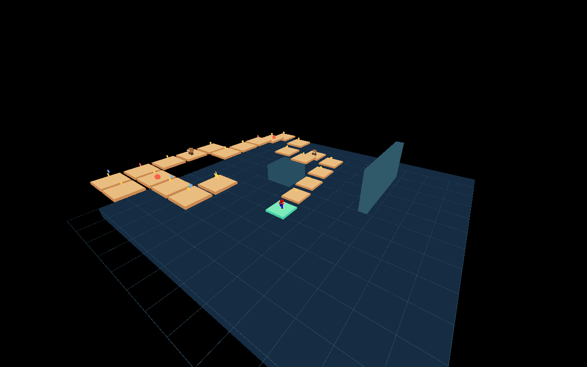
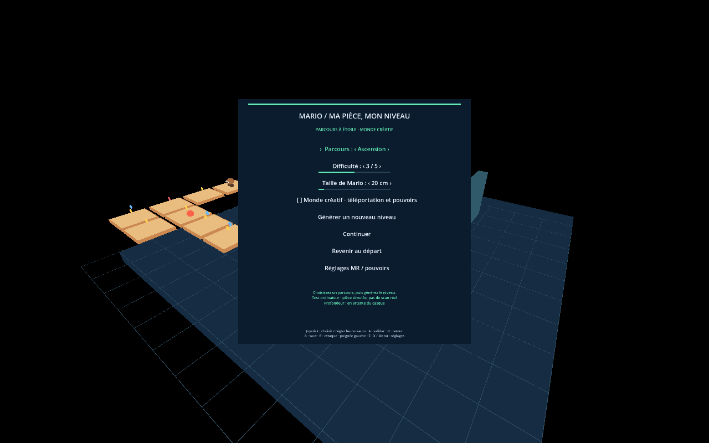

# Mario dans ma pièce — Quest 3 — v0.3.0

[Télécharger l’APK](https://github.com/IXSKY6000/m64-vr-realiter-augmenter/raw/refs/heads/apk-download-v0.3.0/MarioRoom-Quest3.apk)

Installation / mise à jour avec SideQuest ou `adb install -r MarioRoom-Quest3.apk`.
Même signature que les versions précédentes : aucune désinstallation nécessaire.
[Instructions et commandes](INSTALLATION.txt).

## Générateur

Trois types de parcours : **Ascension**, **Serpentin**, **Expédition**. Curseurs de
**difficulté 1–5** et **taille de Mario 15–85 cm**, plus une case **Monde créatif**.
Le niveau s’adapte à la taille et à l’espace connu. Chaque saut requis est simulé
avec le moteur original avant d’autoriser le lancement. Si la place manque, le menu
invite à réduire Mario ; aucun parcours invalidé n’est présenté comme jouable.

En parcours : ennemis simples, dangers, pièces rouges pour débloquer l’étoile et
bonus bleus en hauteur. Les téléportations et rappels ramènent seulement au départ.
En expert, chute/retour au départ remet pièces et ennemis à zéro.

En créatif : placement libre, casquettes ailée/métal/invisibilité disponibles dans
Réglages MR / pouvoirs, envol et pouvoirs renouvelés. Une étoile de sortie reste
présente dans un coin. **Dans les deux modes, l’étoile ramène au menu de génération.**
Changer les réglages pendant une partie prépare le prochain niveau.

## Validation et limites

84 vérifications du générateur et des modes passent, en plus des 10 tests de base
et de la comparaison de 150 ticks avec libsm64. APK ARM64, signature, contenu et
alignement Android vérifiés. Captures sur ordinateur : la pièce et les obstacles
y sont simulés. Le placement réel, les manettes et l’occlusion doivent encore être
vérifiés sur le Quest 3. Le scan statique ne suit pas les meubles déplacés.

Le mode MR sans limite et l’occlusion profondeur de la v0.2 sont conservés. Aucun
niveau original de la ROM ni Goomba original n’est importé : les décors et ennemis
sont procéduraux. Les ressources de Mario sont issues de la ROM fournie par le
propriétaire du dépôt ; la ROM complète n’est pas distribuée. Prototype personnel
non affilié à Nintendo ou Meta.
